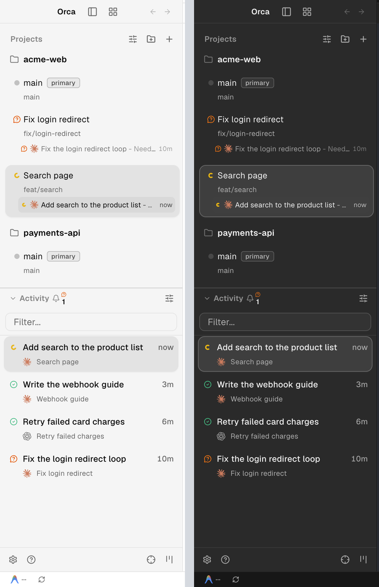
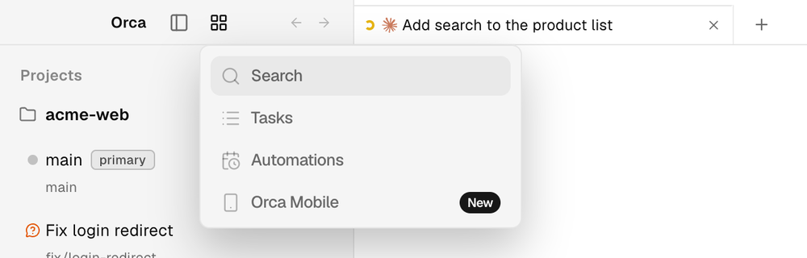
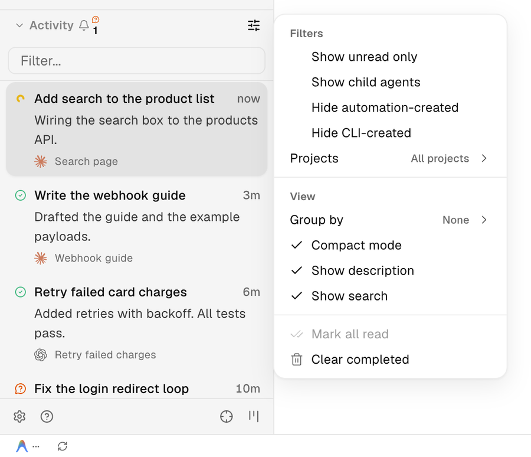
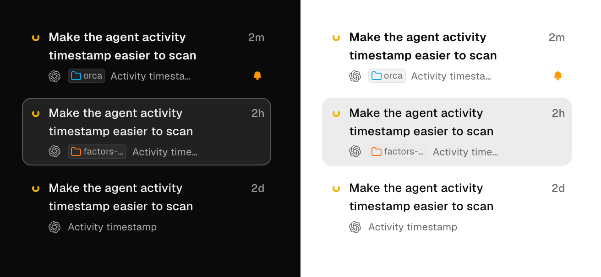
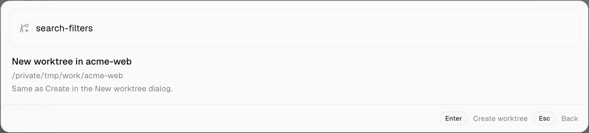
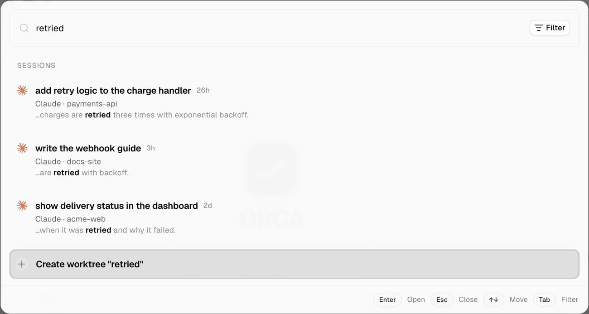

# Orca, unofficial custom build

This is an unofficial fork of [stablyai/orca](https://github.com/stablyai/orca), the app that runs coding agents in parallel, each in its own worktree. It is upstream Orca plus a small stack of patches, rebuilt on every upstream release. It is MIT licensed like upstream, and the original license and copyright notice stay in [LICENSE](../LICENSE). One person maintains it, for personal use. It is not affiliated with or endorsed by the Orca team.

It keeps upstream's bundle id (`com.stablyai.orca`) and the app name Orca, and no patch changes where Orca stores its data. So it replaces the official app in place, and your existing settings should still be there.

[Latest release](https://github.com/balakumardev/orca/releases/latest) | [Install](#install) | [Upstream README](../README.md)

<p align="center">
  
</p>

## What is different

The current changes come first. Each name in `code` is the patch name from the commit trailer `Orca-Custom-Patch: <name>`, and it is the name used in the release notes. Keys use Cmd. Every key below is either a built-in default or a fixed key. None comes from a personal settings file.

### Project TODOs in the sidebar (`project-todos`)

- Each project in the left sidebar has an inline TODO list under its header for quick ideas. Hover a project header and click the TODO button to open it. When a project has open items, the header shows a count pill instead.
- Press Enter in the input to add an item, or double-click an item to edit it. Checked items move under a **Done** toggle with a **Clear done** action.
- You can link an open TODO to an existing worktree in that project, or start a new worktree from it with the name prefilled from the TODO text. Clicking a linked worktree pill switches to that worktree.
- Deleting or cleaning up a linked worktree marks its TODO as done. Putting a worktree to sleep leaves the TODO open.

### Stacked sidebar (`sidebar-layout`)

- The left sidebar shows the workspace list on top and the Activity list below it. A draggable splitter sits between them. Focus the splitter and press the Up or Down arrow key to resize it. The switch between the two views is gone.
- Search, Tasks, Automations and Orca Mobile moved into a **Quick links** popover. Open it with the button in the title bar, next to the sidebar toggle. Artifacts, Skills and Agent Dashboard appear in the same popover when you turn them on in Settings.
- Activity cards hide the description line by default. Open the options menu in the Activity header and tick **Show description** to see it. Orca remembers the choice.
- When you click an agent in Activity, its workspace is also expanded and scrolled into view in the list above.

<p align="center">
  
  
</p>

### Activity keys (`activity-shortcuts`)

| Action in Settings > Shortcuts (group Agents) | Default       |
| --------------------------------------------- | ------------- |
| Previous agent in Activity                    | `Cmd+Shift+;` |
| Next agent in Activity                        | `Cmd+Shift+'` |
| Toggle Activity pane                          | `Cmd+Shift+L` |

The two cycle keys walk the visible Activity rows, skip collapsed groups, wrap at both ends and work while a terminal has focus. The toggle shows or hides the Activity pane. You can change all three in Settings > Shortcuts or in `~/.orca/keybindings.json`.

### Activity follows the focused agent (`activity-follow`)

The highlighted row in Activity follows the agent in the pane you are working in. It moves when an agent starts in a new tab, and when you switch tab, workspace or pane. The list scrolls to the row, and a collapsed group opens first. This only moves the highlight. It does not refocus a terminal or switch workspace. A row you clicked yourself wins over the follow. If the focused pane runs no agent (a plain shell, an editor), the highlight stays where it was.

### Activity card titles (`activity-title`)

An Activity card is titled with the agent session name instead of the last prompt you typed. When the session has no real name yet, the card keeps showing the prompt. In a split tab, each card uses the title of its own pane. This is a port of an upstream change (stablyai/orca#31802).

### Project name on Activity cards (`activity-row-project`)

Each Activity card shows the project next to the workspace name, as a small coloured chip. The workspace name was already on the card. When the sidebar is narrow the project shrinks first (it never takes more than 45% of the line), so the workspace name keeps its space. Hover either one to see the full name. A workspace named like its project shows the name once.

<p>
  
</p>

### Cmd+J: a new worktree in a project (`project-jump`)

Cmd+J opens the worktree palette. Its action name in Settings is "Switch worktree". Orca's own default for it is Cmd+K on a new profile and Cmd+J on a profile that existed before Orca moved it. This README says Cmd+J.

Making a worktree in a project now takes two steps in the palette. First pick the project. Then type a name.

| Keys                                                      | What it does                                                                                                                     |
| --------------------------------------------------------- | -------------------------------------------------------------------------------------------------------------------------------- |
| Cmd+Enter on a highlighted row                            | Starts the name step for the git project that row belongs to. The highlighted row shows a `Cmd+Enter  New worktree` hint         |
| Cmd+Enter on a folder row that is an untracked git folder | Adds the folder as a project, then starts the name step. The row shows `Cmd+Enter  Add + new worktree`. Enter still only adds it |
| Cmd+Shift+Enter                                           | Starts the name step for the project of the workspace you are in, even with an empty search                                      |
| Enter on a "New worktree in `<Project>`" row              | Starts the name step. A typed Enter never lands on this row. Move to it first                                                    |
| Type `project/name`                                       | The last Create row reads `Create "name" in <Project>`. This works only when `project` is the whole title of one git project     |

The footer shows these keys with an empty search too, and each one only when it applies: `Cmd+Enter` with the project of the highlighted row, or `Add + new worktree` on an untracked git folder, and `Cmd+Shift+Enter` with the project of the workspace you are in when that is another project. Task rows, which this fork turns off, would replace them with a `Create workspace` hint. The `Cmd+Enter` hint on a row appears only on the highlighted row, and only where the key does something. It is hidden in a narrow window.

The Create group at the end of the list reads: a "New worktree in `<Project>`" row for each project that matches your text, then the plain Create row. That plain row says which project it opens the New worktree dialog on, for example `Create "notes" in acme-web`. Only the label and the order changed. Enter still opens the workspace you highlighted, never one of these rows.

In the name step, Enter creates the worktree. An empty name does nothing. Esc, or Backspace on an empty name, goes back to your search. These keys are fixed in the palette. They are not in the shortcut settings.

Enter does not create the worktree itself. It hands the name to Orca's New worktree dialog, which stays hidden and presses its own Create button. So your default agent, setup script and branch naming work as they do in that dialog. If the dialog needs input (a setup prompt, an error), it opens in front of you.




### Cmd+J: folders (`folder-jump`)

While you type, Cmd+J also lists folders on your computer that Orca does not track yet. It looks in the folders that hold your existing projects, not on the whole disk. Enter adds the folder as a project: a git folder as a git project, any other folder as a plain folder. A folder row is never the highlighted row until you move to it, so a typed Enter cannot add a folder by accident. On a git folder, Cmd+Enter adds it and then asks for a worktree name in it (see the table above). This works in the desktop app for local projects only.

### Cmd+J: sessions (`session-search`, opt-in)

Cmd+J can list past agent conversations that match what you type. It reads the search index of Orca's Agent Session History. It does nothing until you turn on **Search inside sessions** in Settings (Agent Session Search). The fork never turns it on.

Read this before you turn it on. The index holds the text of your agent conversations on your disk, and Orca does not encrypt it. With it on, every search of two or more characters in Cmd+J can show excerpts of those conversations. A screen share can show them too. **Clear search data** in the same settings removes the index.

Enter on a session row reopens its chat, jumps to the pane that still holds it, or resumes it in the workspace that owns its folder. It resumes in a new terminal tab when Settings open that agent as CLI, and in a new chat tab when they open it as Chat. A session in a folder Orca does not track, or one that cannot be resumed that way, shows as a dimmed row that Enter skips. A typed Enter never opens a session. You must move to the row first.



### Cmd+J: no task rows (`cmdj-no-tasks`)

Cmd+J no longer lists tasks from GitHub, Linear, Jira or GitLab, and it starts no search for them. The Tasks page is still there. One constant, `CMD_J_TASK_SEARCH_ENABLED` in `cmd-j-task-search-switch.ts`, brings the upstream behavior back.

### Stay awake with the lid closed (`lid-closed-awake`, opt-in, macOS)

Upstream's **Keep computer awake** in Agent mode stops idle sleep, but closing the lid still puts a Mac to sleep. This option, in Settings > Agents, keeps the Mac awake with the lid closed while an agent is working in Agent mode. It is off until you turn it on.

It needs a one-time admin step. Orca installs a small root helper and a sudoers rule that allows only two fixed commands (`hold` and `reset`) for your account. Orca then holds sleep off through that helper. The helper lets go by itself if Orca quits, crashes or hangs. **Remove** in the same setting deletes the helper and the rule.

A Mac kept awake in a bag runs warm and loses battery, so the hold has limits and tells you about them. It stops at a battery level you choose (default 30%, on battery power only), when macOS reports a serious thermal state, and after a time limit you choose (default 12 hours). It waits 60 seconds after the agents go idle before it lets go. A status bar item shows when it is holding, with the battery and the time left, and has a **Release now** button. Orca also sends a notification when it starts holding, when the battery gets near the limit, when it stops and why, and when you open the lid ("held awake for 2 h 10 min, battery 80% to 45%"). If an earlier run left the Mac set to never sleep, Orca puts it back at the next start.

It does not hold in On mode, in `orca serve` mode, or for agents on SSH or paired hosts.

### Updates from this fork (`self-updater`, `disable-updater`)

Upstream's built-in updater is off in this build. It would offer upstream's own newer build, which is signed by a different Apple team and would fail the signature check. Instead, the app looks at this fork's releases about 90 seconds after it starts and then every 4 hours. You can also check from the menu or from Settings. It downloads the newest `+custom` release, checks the sha256, the signing team, Apple notarization and the stapled ticket, and stages the update. The restart button on the update card installs it. Nothing quits by itself.

### Build identity and signing (`build-identity`, `release-signing-team`)

Release builds are signed with the fork owner's own Developer ID. Two build-time switches make that possible without changing upstream's code paths. `ORCA_MAC_TEAM_ID` sets the team that the terminal host check expects. `ORCA_BUILD_COMMIT` makes skill-install pins use the upstream tag commit, because the fork's own commit does not exist upstream.

## More coming

This list is short on purpose. It names only things that exist or are written down.

- Every new upstream release is merged in. The open [pull requests](https://github.com/balakumardev/orca/pulls) show the one in progress.
- Ideas, not promises. They come from the known gaps in the [patch index](../.claude/skills/fork-add-customization/SKILL.md): a branch and base preview in the name step, session search for SSH, WSL and paired hosts, and following the floating terminal in the Activity highlight. More Cmd+J and sidebar work is possible. There is no schedule.

## Install

Only macOS on Apple Silicon (arm64) is published. There are no Windows or Linux builds, and no Intel Mac build.

1. Open the [latest release](https://github.com/balakumardev/orca/releases/latest) and download `Orca-<version>-arm64-mac.zip`. A `.sha256` file for it is next to it.
2. Quit Orca if it is running. This applies to the official app and to an older copy of this fork.
3. Unzip the file and drag `Orca.app` into `/Applications`. Replace the old copy.
4. Start it. The build is signed with a Developer ID (team `KHD36T7C97`) and notarized by Apple, so Gatekeeper accepts it. macOS may still ask the usual "downloaded from the internet" question on the first start.

The signing team is not the one that signs the official app. So on the first start macOS may ask for Keychain access again. The Computer Use helper may also need its Accessibility and Screen Recording permissions granted again. After that, updates come from inside the app.

To check the download yourself:

```sh
# in the folder that holds both downloaded files
shasum -a 256 -c 'Orca-<version>-arm64-mac.zip.sha256'
# after you installed the app
codesign -dv --verbose=2 /Applications/Orca.app 2>&1 | grep TeamIdentifier
spctl -a -vvv -t exec /Applications/Orca.app
```

You should see `TeamIdentifier=KHD36T7C97` and `source=Notarized Developer ID`. The release page also lists the patches in each build and the commit it was built from.

## How the fork is maintained

- The default branch `custom` is an upstream release tag plus the patches. It is never rebased or force-pushed. Changes land only through a pull request, and the check `gates / result` must pass first.
- Each patch commit carries a trailer `Orca-Custom-Patch: <name>`. Patches keep edits to upstream files tiny and put new logic in new files, so upstream merges stay clean.
- A scheduled workflow checks every 3 hours for a newer upstream release. It merges the release tag. Scripts resolve what they can. A cloud AI model resolves conflicts in files the patches own.
- Scripts then run the gates: typecheck, lint, format, unit tests, localization and the end-to-end specs of the patches. The sync opens a pull request. When every gate is green and `custom` has not moved, the workflow merges it by itself, with no human review, and a release starts. Otherwise the pull request stays open for the owner to review.
- Every push to `custom` publishes a release named `v<upstream version>+custom.<N>`. `N` only grows. So even a change to this README makes a new release.
- The list of patches, what each one touches and its known gaps is in [`.claude/skills/fork-add-customization/SKILL.md`](../.claude/skills/fork-add-customization/SKILL.md). The sync and release steps are in [`.claude/skills/fork-release-and-sync/SKILL.md`](../.claude/skills/fork-release-and-sync/SKILL.md). The rules for contributors are in [`CLAUDE.md`](../CLAUDE.md).
- Issues are turned off on this repository. A bug in Orca itself belongs in [stablyai/orca](https://github.com/stablyai/orca/issues). For a problem that only this fork has, open a pull request.

## Known limits

- The patches were checked in a headless test harness on macOS and by the author's daily use. They were not checked on Windows, Linux, WSL or SSH hosts, and not with a paired remote host.
- Apple Silicon only.
- Session search is opt-in, it stores conversation text without encryption, and it works for the local computer only. It also waits for the first full index pass, which can take a while on a large history.
- The Activity keys do not fire while an embedded browser or a text input has focus. The Activity highlight does not follow the floating terminal or the full-page Activity view. It does not highlight an agent that a filter hides.
- The name step in Cmd+J shows no branch or base preview.
- Stay awake with the lid closed was checked with unit tests and an offline run of its installer, not yet with a real closed lid. macOS itself decides whether `pmset disablesleep` holds a closed lid on a given Mac, and sources disagree. Try it with the Mac plugged in first, and watch the first runs.
- The first-run tour step about sidebar navigation may point at buttons that moved into the Quick links popover. This was a known gap at the last review.
- In-app updating is new and has had little real use. If an update does not install, download the zip from the releases page and replace the app by hand.
- This fork is unofficial. The Orca team does not support it. Please do not report its problems to them.
